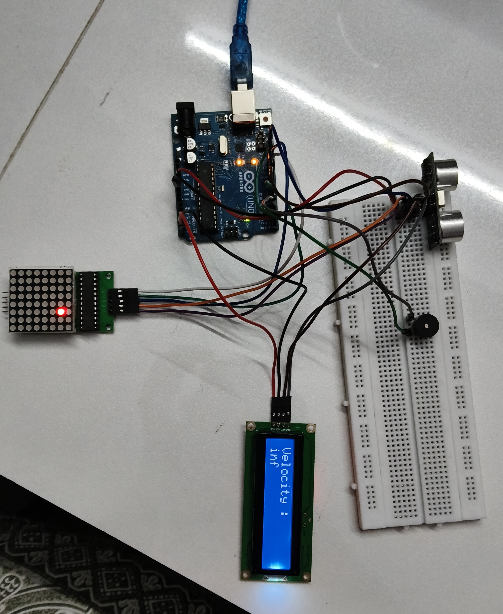

# Ultrasonic Velocity Detector with LED Matrix and LCD

An Arduino Uno project that measures the distance to an object using an
ultrasonic proximity sensor, displays the calculated velocity on a 16×2
I²C LCD, and moves a light across an 8×8 LED matrix according to the
object's distance. A buzzer gives an audible alert when the detected
distance region changes.

## Project setup

*Prototype showing the Arduino Uno, ultrasonic sensor, 8×8 LED matrix,
LCD, buzzer, and breadboard wiring.*

## Features

-   Measures object distance with an ultrasonic sensor (for example, an
    HC-SR04).
-   Displays the calculated velocity value on the LCD.
-   Uses an 8×8 LED matrix to indicate the detected distance region:
    -   **More than 30 cm:** the LED is set to the top-left starting
        position.
    -   **More than 15 cm and up to 30 cm:** the LED advances along the
        matrix's column direction.
    -   **More than 0 cm and up to 15 cm:** the LED advances along the
        matrix's row direction.
-   Sounds the buzzer when the detected region changes.
-   Prints distance and velocity readings to the Serial Monitor.

## Hardware required

-   Arduino Uno (or compatible board)
-   Ultrasonic distance sensor (HC-SR04-compatible)
-   8×8 LED matrix module with MAX7219 driver
-   16×2 LCD with I²C backpack
-   Active buzzer (or a buzzer compatible with the sketch's HIGH/LOW
    drive)
-   Breadboard and jumper wires
-   USB cable and suitable power connections

## Wiring

  Component            Module pin     Arduino Uno pin
  -------------------- ------------ -----------------
  Ultrasonic sensor    TRIG                        D9
  Ultrasonic sensor    ECHO                       D10
  Buzzer               Signal / +                  D4
  MAX7219 LED matrix   DIN                        D12
  MAX7219 LED matrix   CLK                        D11
  MAX7219 LED matrix   CS / LOAD                   D6
  I²C LCD              SDA                         A4
  I²C LCD              SCL                         A5

Connect each module's **VCC** and **GND** according to its voltage
requirements, and make sure all modules share a common ground with the
Arduino. The LCD address in the sketch is `0x27`; change it if your I²C
backpack uses a different address.

## Software and libraries

1.  Install the [Arduino IDE](https://www.arduino.cc/en/software).
2.  Install these libraries through **Tools → Manage Libraries** (or the
    Library Manager):
    -   `LedControl`
    -   `LiquidCrystal_I2C`
    -   `Wire` (normally included with the Arduino AVR board package)
3.  Open the Arduino sketch in the IDE.
4.  Select your Arduino board and port.
5.  Upload the sketch.
6.  Open Serial Monitor at **9600 baud** to view the readings.

## How it works

1.  The Arduino sends a short trigger pulse to the ultrasonic sensor.
2.  It measures the echo pulse using `pulseIn()` and converts the pulse
    duration into distance in centimetres.
3.  The distance range determines how the LED matrix is updated.
4.  When the range state changes, the buzzer sounds briefly.
5.  The sketch calculates a velocity value from the current and previous
    distance values and prints it to the LCD and Serial Monitor.

## Notes and limitations

-   The displayed velocity is the value calculated by the current
    sketch; it should be treated as an experimental estimate, not a
    calibrated measurement.
-   In the current code, the denominator uses the ultrasonic echo-pulse
    duration plus the accumulated buzzer delay. That is not the same as
    the elapsed time between consecutive distance samples, so the
    velocity calculation should be improved before using it for accurate
    measurements.
-   The sketch does not currently calculate a signed direction of motion
    reliably, and it does not explicitly label the velocity unit on the
    LCD.
-   If no echo is received within the `pulseIn()` timeout, the Serial
    Monitor reports `No echo detected` and the buzzer sounds when
    entering the no-echo state.
-   The LED movement wraps around the 8×8 matrix.

## Future improvements

-   Add a humidity sensor and use environmental measurements to improve
    the speed-of-sound compensation used for distance calculations.
-   Calculate velocity using the actual elapsed time between consecutive
    valid distance samples (for example, with `millis()` or `micros()`),
    rather than the echo-pulse duration.
-   Display the velocity unit and handle invalid/no-echo readings more
    clearly.
-   Add filtering or averaging to reduce measurement noise.

